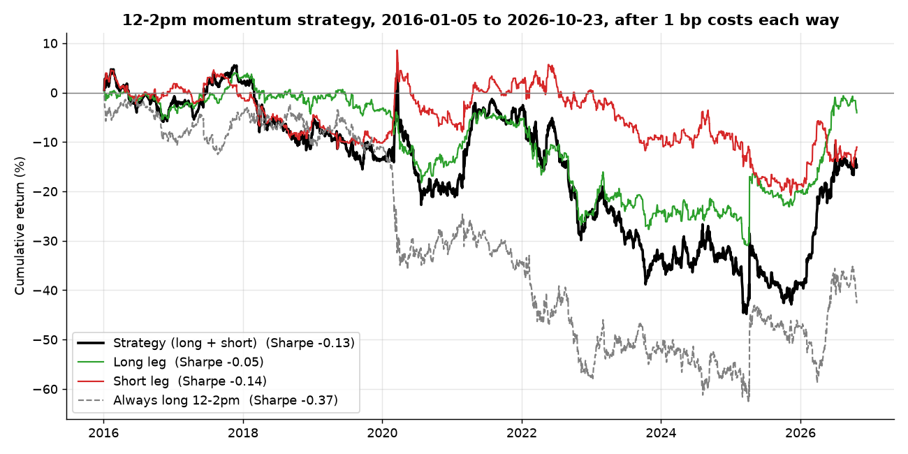
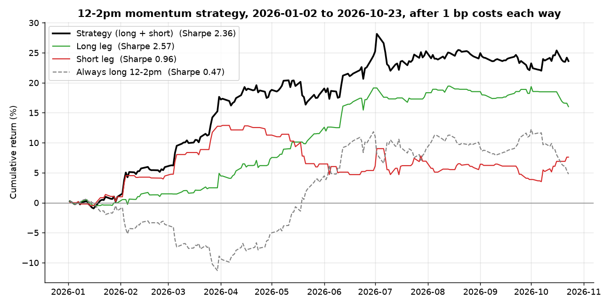
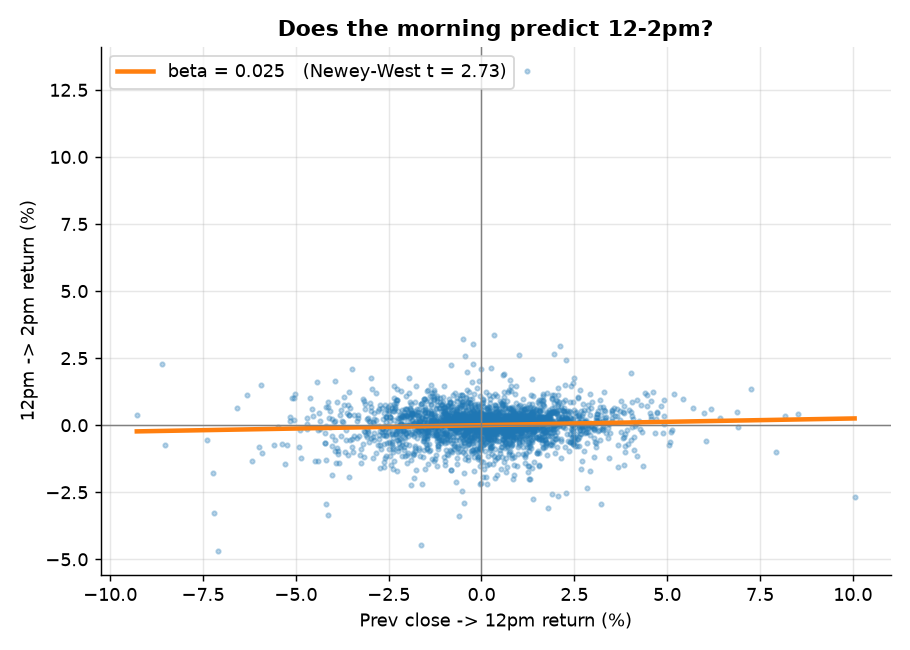
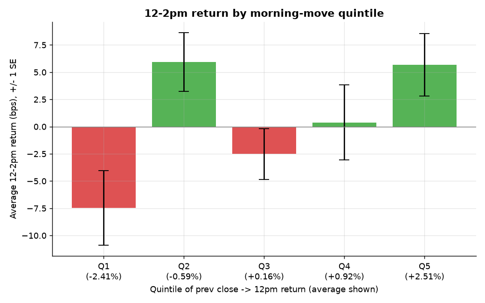
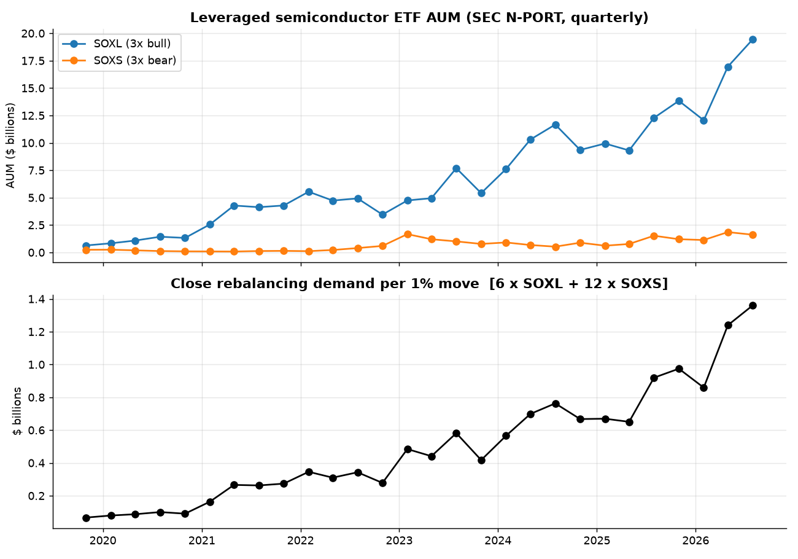
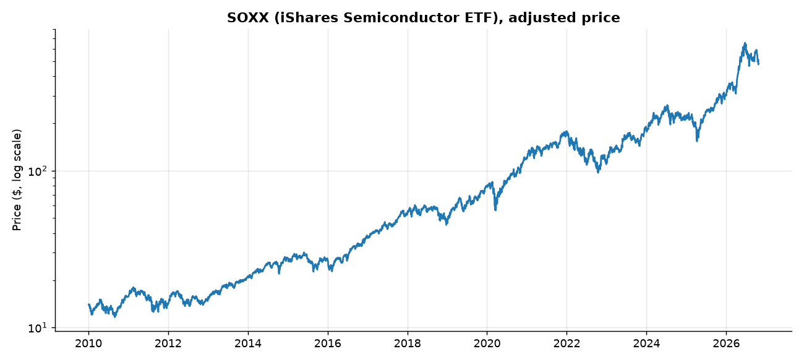
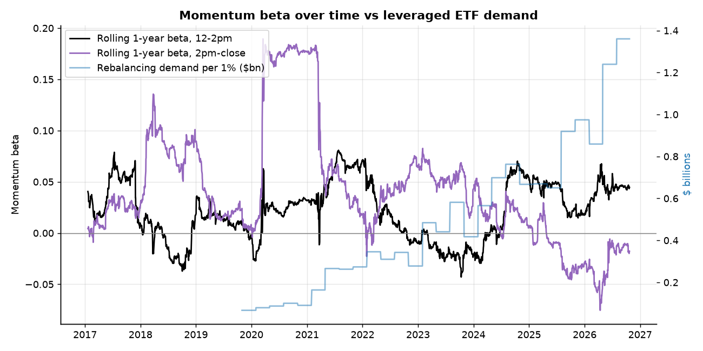

# Do Leveraged ETFs Amplify Intraday Momentum in Semiconductors?

*Author: Pedro Ribas · Last updated: [11/23/26]*


## Summary

 Leveraged ETFs such as SOXL (3x) and SOXS (−3x) must buy semiconductor exposure on up days and sell on down days at every close. I test whether market makers pre-position for these flows at midday, making the morning move predict the 12–2pm return in SOXX, and whether a strategy trading that signal beats holding semis. Using 5-minute data from 2016 to 2026, I find small but statistically significant midday momentum (β ≈ 0.025, t ≈ 2.7), but the strategy is not profitable after costs when taking into account every year (Sharpe −0.13 vs 0.96 for holding SOXX), even when trading only big-move days. However, when looking only at 2026, the strategy trades very well (Sharpe 2.61 vs 0.87 for holding SOXX ). This is likely due to larger demand from leveraged ETFs. Over the course of 2026, it is shown that markets have not been able to absorb the momentum created from leveraged ETFs. Although, it is important to recognize that the strategy has not been significantly effective in other years and 2026 is a small sample size.


## 1. Question and hypothesis

Leveraged ETFs such as SOXL (3x) and SOXS (−3x) must rebalance at every close, buying
on up days and selling on down days. The hypothesis tested here:

1. By midday, the size of the day's move tells you roughly how much these funds must trade at the close.
2. Market makers pre-position for that flow during the quiet 12–2pm window.
3. So the morning move (previous close → 12pm) should predict the 12–2pm return (momentum).
4. The effect should grow as leveraged ETF assets grow.

This is interesting because the data for 2026 is the only data that is significant enough to trade off of and although it is a small sample size, it could be due to larger demand from leveraged ETFs in 2026 which is allowing them to have a larger effect on the market. The results of this strategy should continue to be closely monitored to increase sample size and monitor demand of leveraged ETFs in the semi-conductor industry.  


## 2. Mechanism

A fund with leverage L and assets A must trade, at the close, after a day's return r:

```
rebalance trade = L × (L − 1) × A × r
```

| Fund | Leverage L | L(L−1) | Trades on an up day |
| --- | --- | --- | --- |
| SOXL | 3 | 6 | Buys |
| SOXS | −3 | 12 | Buys (covers short) |

To see why, consider a SOXL fund with $1B of investor capital. To deliver 3× daily returns, it holds $3B of semiconductor exposure. If semis rise 2%, the exposure gains $60M, so the fund is now worth $1.06B, but its exposure has only grown to $3.06B. To reset to exactly 3× ($3.18B), the fund must buy $120M of semiconductor exposure at the close.
The bear fund behaves the same way. A $1B SOXS fund holds a $3B short position. When semis rise 2%, the short loses $60M, shrinking the fund to $0.94B, while the short itself grows to $3.06B as the shorted stocks rise. To reset to −3× (−$2.82B), the fund must cover part of its short, buying back $240M.
Both funds therefore buy after up days and sell after down days, trading in the direction of the market’s move. The bear fund trades twice as much per dollar of assets (L(L−1) = 12 vs 6). Applied to actual fund sizes in July 2026 (SOXL $19.4bn, SOXS $1.6bn), a 1% move in semiconductors requires roughly $1.4bn of combined rebalancing at the close, up from about $67M in late 2019.
Because these flows are mechanical and predictable from the day’s move, the hypothesis is that market makers anticipate them during the quiet midday window, pushing prices further in the morning’s direction.

## 3. Data

| Data | Source | Frequency | Period |
| --- | --- | --- | --- |
| SOXX prices | Alpaca Market Data API (SIP feed) | 5-minute bars | 2016-01 – 2026-10 |
| SOXX daily prices | Yahoo Finance (yfinance) | Daily | 2016 – 2026 |
| XLU prices (placebo) | Alpaca Market Data API | 5-minute bars | 2016 – 2026 |
| SOXL / SOXS net assets | SEC EDGAR, Form N-PORT | Quarterly | 2019-10 – 2026-07 |

**Variables (one row per trading day, 2,688 days):**
- `signal`: return from previous close to 12:00
- `target`: return from 12:00 to 14:00
- comparison windows: 14:00 → close, 15:30 → close

**Limitations:** AUM is quarterly and only starts in late 2019; half days are dropped;
costs are assumed at 1 bp each way.

## 4. Backtest: is the 12–2pm signal tradable?

Rule: long SOXX 12:00–14:00 if the morning was up, short if down. Cost: 1 bp each way.
Full sample, 2016–2026.

| | Sharpe | Avg bps / trade | Hit rate | Trades |
| --- | --- | --- | --- | --- |
| Strategy (long + short) | 0.12 | 0.44 | 49.81% | 2656 |
| Long leg | 0.19 | 0.99 | 52.15 | 1465 |
| Short leg | −0.04 | −0.26 | 46.94% | 1191 |
| Always long 12–2pm (with costs) | 0.22 | 0.82 | 52.24% | 2674 |
| SOXX buy & hold | 0.96 | 13.13 | 54.60 | 2674 |



**Variations tested (all reported, not just the best):**

| Variation | Sharpe | Avg bps / trade |
| --- | --- | --- |
| Zero costs | 0.64 | 2.44 |
| Big-move days only (abs(signal) >= 1%) | 0.76 | 5.42 |
| 12:30–14:00 window | 0.63 | 2.42 |
| 2023 onwards only | 0.57 | 2.93 |
| 2026 only | 2.76 | 13.56 |
| 2026 only (abs(signal) >= 1%) | 3.35 | 18.73



The strategy is not profitable after costs over the full sample, but there is an edge before costs. However, during 2026, the strategy has been profitable and has a sharpe ratio of 2.76 and if we look at only big move days defined by a greater than 1% morning move in SOXX, the sharpe jumps to 3.35. This could be due to larger demand in leveraged ETFs so although 2026 is a small sample, we also see that the sharpe has been increasing since 2023, so there is a correlation of increased leveraged ETF demand and the sharpe of the strategy. 

## 5. Does the morning predict the afternoon?

Regression: `window return = a + β × signal`, Newey-West t-stats, 2,674 days.

| Window | β | t-stat |
| --- | --- | --- |
| 12:00–14:00 | 0.0250 | 2.73 |
| 12:30–14:00 | 0.0165 | 1.83 |
| 14:00–close | 0.0365 | 2.51 |
| 15:30–close | 0.0170 | 1.89 |



**Quintiles (12–2pm):**

| Quintile | Avg morning move | Avg 12–2pm return |
| --- | --- | --- |
| Q1 | −2.41% | −7.5 bps |
| Q2 | −0.59% | +5.9 bps |
| Q3 | +0.16% | −2.5 bps |
| Q4 | +0.92% | +0.4 bps |
| Q5 | +2.51% | +5.7 bps |



Sorting days into quintiles by the morning move shows where the momentum lives. On the biggest down mornings (Q1, average −2.4%), SOXX continued to fall from 12 to 2pm by 7.5 bps on average, and on the biggest up mornings (Q5, +2.5%) it continued to rise by 5.7 bps. The middle quintiles show no consistent pattern, and Q2 even shows a small rebound (+5.9 bps), likely noise given standard errors of about 3 bps per quintile. The effect is therefore concentrated on large-move days, consistent with leveraged ETF rebalancing scaling with the size of the move. It also explains why the every-day strategy fails: most of its trades fall on days with no edge, yet each pays the full trading cost.


## 6. Did leveraged ETF growth amplify momentum?

SOXL grew from $0.63bn to $19.4bn and SOXS from $0.24bn to $1.6bn. Close rebalancing
demand per 1% move rose from about $67M to about $1.36bn (~20×).





**Momentum β in low vs high demand periods, and interaction test (`signal × demand`):**

| Window | β low demand | β high demand | Interaction coef | t-stat |
| --- | --- | --- | --- | --- |
| 12:00–14:00 | 0.022 (t 1.2) | 0.033 (t 2.7) | +0.0025 | 0.19 |
| 14:00–close | 0.090 (t 3.0) | −0.006 (t −0.5) | −0.0563 | −2.87 |
| 15:30–close | 0.033 (t 1.8) | 0.002 (t 0.1) | −0.0199 | −1.44 |


Despite rebalancing demand roughly tripling between the low- and high-demand periods, midday momentum did not significantly strengthen: the 12–2pm beta rose only from 0.022 to 0.033, and the interaction term is far from significant (t = 0.19). Afternoon momentum instead faded. The 2pm–close beta fell from 0.090 (t = 3.0) to about zero, with a significantly negative interaction (t = −2.87), and the last 30 minutes shows the same pattern, though not significantly. This is the opposite of the hypothesis: rather than amplifying momentum, growing leveraged ETF demand coincided with momentum weakening near the close, consistent with markets learning to absorb large, predictable flows. The result weakens but survives when 2020 is excluded (t = −2.08).


## 7. Placebo: utilities (XLU)

Same test on XLU (little leveraged ETF money), comparing β before vs after July 2023.

| Window | Ticker | β before | β after | Change | t-stat of change |
| --- | --- | --- | --- | --- | --- |
| 12:00–14:00 | SOXX | 0.017 | 0.037 | +0.020 | 0.95 |
| 12:00–14:00 | XLU | 0.034 | −0.037 | −0.071 | −1.99 |
| 14:00–close | SOXX | 0.092 | −0.012 | −0.104 | −3.18 |
| 14:00–close | XLU | 0.039 | 0.021 | −0.018 | −0.44 |
| 15:30–close | SOXX | 0.033 | 0.000 | −0.033 | −1.51 |
| 15:30–close | XLU | 0.002 | 0.013 | +0.011 | 0.45 |

Afternoon momentum faded sharply in SOXX after mid-2023 (2pm–close beta from 0.092 to −0.012, t = −3.18) but barely changed in utilities (0.039 to 0.021, t = −0.44). Because XLU has very little leveraged ETF money, this argues against a market-wide explanation and points to something specific to semiconductors, consistent with the growth of SOXL and SOXS. Midday momentum moved in opposite directions in the two ETFs (up in SOXX, down in XLU), but neither change is clearly significant. Two caveats apply. First, the difference between the SOXX and XLU changes is itself only marginally significant (t ≈ −1.6). Second, semiconductors changed in other ways after 2023, including the AI boom and heavier retail options activity. The placebo therefore narrows the possible explanations rather than proving the leveraged ETF one.

## 8. Robustness

| Check | Result |
| --- | --- |
| Excluding 2020 (Phase 5) | 14:00–close interaction −0.022, t −2.08 (weaker but still significant); 15:30–close effect disappears |
| Excluding 2020 (placebo) | [ ] |
| Higher costs (2 bp, 5 bp) | [ ] |
| Big-move threshold (0.5%, 1.5%) | [ ] |

**Multiple testing:** [number] windows × samples were tested. One result with p ≈ 0.04
across that many tests could occur by chance; conclusions are stated accordingly.

## 9. Conclusion

Midday momentum exists, but it isn't tradable based on the sample tested. The morning move does predict the 12–2pm return (β ≈ 0.025, t ≈ 2.7), but the effect is small and concentrated on the biggest up and down mornings. Traded every day, the strategy loses money after 1 bp costs (Sharpe −0.13, versus 0.96 for simply holding SOXX), and restricting to big-move days did not make it profitable over the full sample. The strategy performed strongly in 2026 and there is a trend towards the strategy having better results over recent years with leveraged ETF growth. 
Leveraged ETF growth did not amplify momentum. Between late 2019 and mid-2026, the money SOXL and SOXS must trade at the close per 1% move grew about 20×, from roughly $67M to $1.4bn. Yet midday momentum did not significantly strengthen as this demand grew (interaction t = 0.19). Afternoon momentum moved the other way: the 2pm–close beta fell from 0.090 to about zero, a significant decline (t = −2.87) that survives, though weaker, when 2020 is excluded (t = −2.08). The same fading did not appear in utilities (XLU), which have little leveraged ETF money, pointing to something specific to semiconductors rather than a market-wide change.
The most consistent interpretation is that markets have learned to absorb large, predictable leveraged ETF flows, rather than those flows pushing prices further. Because the rebalancing is mechanical and its size can be estimated hours in advance, market makers and other traders can spread it out or trade ahead of it, leaving little price impact at the close.
These conclusions are suggestive rather than definitive. The AUM data is quarterly and only begins in 2019; leveraged demand grew alongside time, so other changes in semiconductors after 2023 (the AI boom, heavier retail options trading, single-stock leveraged ETFs) cannot be fully ruled out; the key fading result is only marginally significant once 2020 is excluded; and around 16 tests were run, so any single result near p = 0.04 should be treated with caution. Daily AUM data and a broader set of leveraged products would allow a sharper test.


Limitations:
- AUM is quarterly and starts in 2019; daily AUM (e.g. from Bloomberg/FactSet) would sharpen the tests.
- Demand grew alongside time, so other changes after 2023 (AI boom, retail options) can't be fully ruled out.
- Only SOXL and SOXS are counted. Other leveraged semiconductor products, such as ProShares' 2x semiconductor ETF (USD) and the fast-growing single-stock leveraged ETFs on Nvidia, AMD and Broadcom, trade the same stocks but are left out. Total leveraged flow is likely understated, especially recently.
Next Steps:
- Get daily AUM: daily shares-outstanding data, from Direxion's published fund data or a terminal such as Bloomberg or FactSet, would allow sharper tests than quarterly filings.
- Count all leveraged products: add USD and the single-stock leveraged ETFs on the largest SOXX holdings to the demand measure.
- Event study on big-flow days: compare days with unusually large expected rebalancing (big move × high AUM) against similar-sized moves when AUM was small.
- Control for options activity: add options dealer positioning (gamma exposure) as a second explanation to separate it from leveraged ETF effects.


## How to run

```bash
python3 -m venv .venv
source .venv/bin/activate
pip install -r requirements.txt
# add your Alpaca keys to keys.py (not committed)
python data.py        # download prices
python sec_aum.py     # download SOXL/SOXS net assets from SEC
python features.py    # build the daily table
python backtest.py    # strategy and legs
python stats.py       # regressions and quintiles
python phase5.py      # leveraged ETF tests
python placebo.py     # XLU placebo
python plots.py       # final charts in output/final/
```
